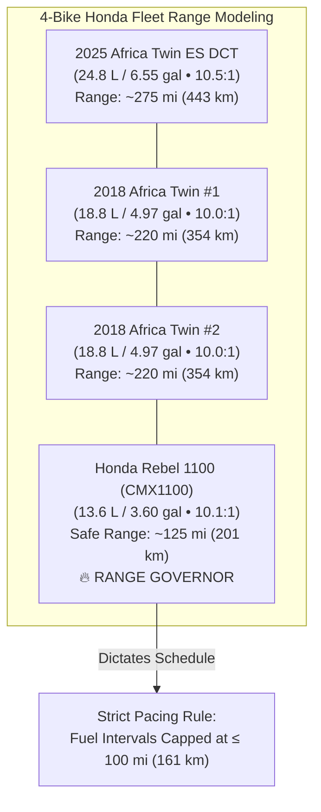

# Blue Ridge Parkway & Appalachian Twisties: Master Saddle & Fuel Logistics
### 7-Day Operational Cadence • 4-Bike Honda Fleet Range Analysis • 15 Strategic Gap Fuel Stations

---

## 1. Fleet Dynamics & Fuel Compression Physics

The expedition party operates a unified fleet of four modern **Honda Unicam Parallel-Twin motorcycles**. This fleet configuration provides an outstanding mechanical and economic advantage: **100% compatibility with standard 87 AKI Regular Unleaded fuel**.

Unlike high-strung European adventure machines (e.g. Ducati Testastretta at 12.6:1 or BMW ShiftCam at 12.5:1 which demand mandatory 91+ AKI Premium), the Honda Unicam engines feature moderate compression ratios engineered for rock-solid reliability on standard pump gas anywhere in North America.

### Fleet Fuel & Compression Specifications:

| Motorcycle | Engine | Compression | Tank Capacity | Safe Range (Mountain) | Min. Octane | Expedition Role |
| :--- | :--- | :---: | :---: | :---: | :---: | :--- |
| **2025 Honda Africa Twin Adventure Sports ES DCT** | 1,084cc Unicam Twin | 10.5:1 | **24.8 L (6.55 US gal)** | **~275 mi (443 km)** | **87 AKI Regular** | Expedition Flagship / Lead Tanker |
| **2018 Honda Africa Twin CRF1000L Standard #1** | 998cc Unicam Twin | 10.0:1 | **18.8 L (4.97 US gal)** | **~220 mi (354 km)** | **87 AKI Regular** | ADV Scout |
| **2018 Honda Africa Twin CRF1000L Standard #2** | 998cc Unicam Twin | 10.0:1 | **18.8 L (4.97 US gal)** | **~220 mi (354 km)** | **87 AKI Regular** | ADV Wingman |
| **Honda Rebel 1100 (CMX1100)** | 1,084cc Unicam Twin | 10.1:1 | **13.6 L (3.60 US gal)** | **~125 mi (201 km)** | **87 AKI Regular** | Cruiser / **Expedition Range Governor** |

---

## 2. The Rebel 1100 Fuel Range Governor Rule

> [!IMPORTANT]
> **The 100-Mile (161 km) Mountain Safety Threshold**:
> While the three Africa Twins can easily ride 200–275 mi (322–443 km) without stopping, the **Honda Rebel 1100 carries a 3.60-gallon (13.6L) fuel tank**. Under continuous mountain climbs, steep grade accelerations, and headwind ridge riding, the Rebel achieves ~45–48 mpg. 
> 
> Its low-fuel warning icon illuminates after consuming approximately **2.5 to 2.7 gallons**, leaving only 0.9 gallons in reserve (~40 mi [64 km]).
> 
> To guarantee **zero riders ever encounter a low-fuel emergency on remote high-elevation parkway ridges**, our expedition schedule enforces a strict standard:
> **Maximum distance between fuel stops is capped at 60 to 90 miles (97 to 145 km) (never exceeding 100 miles [161 km])**.

---

## 3. Directory of 15 Strategic Gap Fuel Stations (87 AKI Regular)

Because commercial gas stations are **prohibited on the Blue Ridge Parkway motor road itself**, fuel must be accessed by descending 1 to 4 miles down state highway gaps. The following 15 vetted stations provide immediate ramp access and 87 AKI Regular fuel:

| Stage | Highway Exit / Gap | Station Name & Brand | GPS Coordinates | Parkway MP / Proximity | Staging Distance (Rebel 1100) |
| :---: | :--- | :--- | :---: | :---: | :---: |
| **D1** | Front Royal North | Sheetz / Exxon Front Royal | `38.9056, -78.1989` | Basecamp Rollout | Fill all tanks at rollout |
| **D1** | Skyline Drive Central | Big Meadows Wayside Gas | `38.5178, -78.4361` | Skyline MP 51.0 (On-Road) | 53 mi (85 km) from Front Royal |
| **D1** | Rockfish Gap | Sheetz / Exxon Waynesboro | `38.0461, -78.8892` | Skyline MP 105 / BRP MP 0 | 54 mi (87 km) from Big Meadows |
| **D2** | Buchanan Gap | BP / Exxon Buchanan | `37.5231, -79.6789` | BRP MP 90.0 (4 mi [6.4 km] on VA-43) | 90 mi (145 km) from Waynesboro |
| **D2** | Roanoke Gap | Sheetz / Sunoco Roanoke | `37.2289, -79.9575` | BRP MP 121.0 (1 mi [1.6 km] on US-220) | 36 mi (58 km) from Buchanan |
| **D3** | Meadows of Dan | Exxon Meadows of Dan | `36.7356, -80.4128` | BRP MP 177.7 (0.5 mi [0.8 km] on US-58) | 57 mi (92 km) from Roanoke |
| **D3** | Fancy Gap | Pilot / Shell Fancy Gap | `36.6667, -80.6978` | BRP MP 215.0 (0.2 mi [0.3 km] on US-52) | 38 mi (61 km) from Meadows of Dan |
| **D3** | Glendale Springs | Exxon Glendale Springs | `36.3456, -81.3889` | BRP MP 261.0 (1 mi [1.6 km] on NC-16) | 46 mi (74 km) from Fancy Gap |
| **D3** | Blowing Rock | Exxon / Speedway Blowing Rock | `36.1342, -81.6778` | BRP MP 291.8 (1 mi [1.6 km] on US-321) | 33 mi (53 km) from Glendale Springs |
| **D4** | Little Switzerland | BP Little Switzerland | `35.8456, -82.0975` | BRP MP 334.0 (0.5 mi [0.8 km] on NC-226A) | 42 mi (68 km) from Blowing Rock |
| **D4** | Asheville East | Ingles / BP Asheville East | `35.5892, -82.4856` | BRP MP 382.0 (1 mi [1.6 km] on US-70) | 48 mi (77 km) from Switzerland |
| **D4** | Balsam Gap | Enmarket / Shell Balsam Gap | `35.4128, -83.0875` | BRP MP 443.0 (0.5 mi [0.8 km] on US-23) | 61 mi (98 km) from Asheville |
| **D4** | Cherokee Terminus | Exxon / Harrah's Cherokee | `35.4789, -83.3156` | BRP MP 469.0 (Cherokee US-441) | 26 mi (42 km) from Balsam Gap |
| **D5** | Robbinsville Gateway | Shell / Exxon Robbinsville | `35.3236, -83.8075` | Deals Gap Base (US-129) | 73 mi (117 km) from Cherokee |
| **D5** | Tellico Plains Gateway | Shell Tellico Plains | `35.3636, -84.3047` | Cherohala Skyway West (TN-165) | 56 mi (90 km) from Robbinsville |
| **D5** | Valley Corridor | Sheetz / Marathon Greeneville | `36.1628, -82.8311` | US-11E Corridor | 110 mi (177 km) from Tellico Plains (Midway Stop) |
| **D6** | Marion Gateway | BP / Shell Marion | `36.8344, -81.5147` | Back of the Dragon South (US-11) | 37 mi (60 km) from Bristol |
| **D6** | Tazewell Northern Terminus | Exxon Tazewell | `37.1289, -81.5189` | Back of the Dragon North (US-19) | 32 mi (51 km) from Marion (Dragon Complete!) |
| **D6** | New River Valley | Shell Rich Creek / Pearisburg | `37.3789, -80.8242` | US-460 / VA-42 Corridor | 50 mi (80 km) from Tazewell |
| **D6** | Clifton Forge | Sheetz / Exxon Clifton Forge | `37.8189, -79.8242` | I-64 / US-220 Corridor | 81 mi (130 km) from Rich Creek |
| **D7** | Highland County | Highland Mart / Exxon Monterey | `38.4122, -79.5798` | US-250 / US-220 Intersection | 31 mi (50 km) from Warm Springs |
| **D7** | Shenandoah Valley | Sheetz Harrisonburg | `38.4495, -78.8689` | VA-42 / US-11 Corridor | 75 mi (121 km) from Monterey |
| **D7** | Front Royal Finish | Pilot Travel Center Front Royal | `38.9612, -78.2045` | Basecamp Finish (Guard Hill Rd) | 76 mi (122 km) from Harrisonburg |

---

## 4. Daily Operational Cadence Standards

Our daily schedule follows a time-tested adventure touring cadence designed to maximize daylight riding, prevent physical fatigue, and ensure leisurely dining:

1. **Standard 07:00 AM Wake & Breakfast**:
   - 30 minutes to review morning weather/fog advisories, eat breakfast, inspect tire pressures and oil sight-glasses, and pack side panniers.
   - **Wheels roll at 07:30 AM sharp!**
2. **In-the-Saddle Stint Durations**:
   - Highway/Parkway saddle stints are capped at **40 to 65 minutes** between panoramic overlook stops.
   - Continuous seat time never exceeds **2 hours** without a foot stretch and hydration break.
3. **Midday Lunch & Fuel Rhythm**:
   - 30 to 45 minutes scheduled between 11:45 AM and 01:00 PM, paired with a strategic fuel top-up for the Rebel 1100 to eliminate downtime.
4. **Early Evening Arrival & Leisure**:
   - Arrival at nightly mountain hotels between **01:40 PM and 05:00 PM**, allowing ample daylight to explore historic mountain towns (Blowing Rock, Little Switzerland, Abingdon, Warm Springs), soak in hot springs, and enjoy evening meals.
