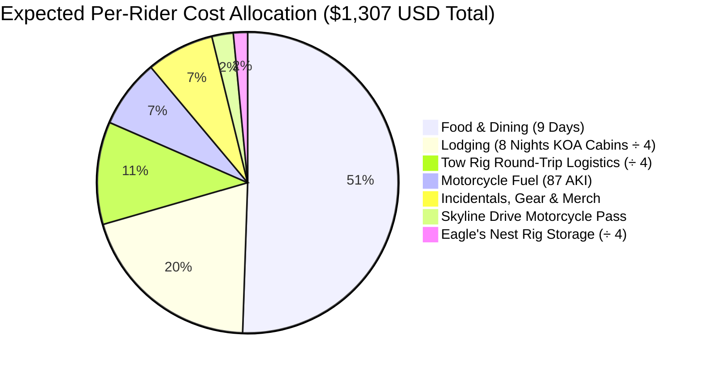

# Blue Ridge Parkway & Appalachian Twisties: Expedition Cost Breakdown (Per Person)
### 4-Rider Party • 2025 RAM 2500 Cummins Haul • 16-Ft Cargo Trailer • 7-Day Motorcycle Tour • 2,789.6 Total Miles (4,489.4 km)

---

## 1. Executive Summary: All-In Cost Per Rider (Full Round-Trip Model)

This budget analysis provides a realistic, comprehensive, itemized financial model for a **4-rider group originating from Hanmer, Ontario**, trailering four Honda motorcycles to **Front Royal, Virginia**, riding **Skyline Drive**, the **Blue Ridge Parkway**, the **Tail of the Dragon**, the **Cherohala Skyway**, and the **Back of the Dragon**, and returning door-to-door.

> [!IMPORTANT]
> **Complete Round-Trip Truck Architecture**: This financial model explicitly accounts for **both legs of the tow rig transit** — the **720.3-mile outbound haul** (Hanmer $\rightarrow$ Front Royal on Day 0) and the **723.5-mile return haul** (Front Royal $\rightarrow$ Hanmer on Day 8) — including diesel fuel across Ontario and the US, DEF fluid, border tolls, highway tolls, trailer staging, post-ride loading rest (Night 7), and travel-day meals for the entire 9-day expedition.

All shared fixed expenses (**RAM 2500 Cummins diesel & DEF**, **border bridge tolls**, **Eagle's Nest trailer staging**, and **KOA cabins**) are split equally **4 ways**. Currency conversions use **1.36 CAD/USD**.

| Expense Category | Allocation Type | Budget Tier (Cookouts / Thrifty) | ⭐ Expected Tier (KOA Cabins & Diners) | Comfort Tier (Private Hotel Rooms) | Expected CAD (@ 1.36 FX) |
| :--- | :---: | :---: | :---: | :---: | :---: |
| **Tow Rig Round-Trip Transit (1,444 mi Diesel, DEF, Tolls, Straps)** | Shared (÷4) | $125 USD | **$144.25 USD** | $165 USD | ~$196 CAD |
| **Eagle's Nest Rig Storage (1 Wk Basecamp Staging)** | Shared (÷4) | $18 USD | **$20.00 USD** | $25 USD | ~$27 CAD |
| **KOA Cabins / Lodging (8 Nights Total: Nights 0 to 7)** | Shared (÷4) | $220 USD | **$261.25 USD** | $580 USD *(Private)* | ~$355 CAD |
| **Motorcycle Fuel (1,346 mi @ 87 AKI Regular)** | Individual | $90 USD | **$96.50 USD** | $110 USD | ~$131 CAD |
| **Skyline Drive 7-Day Motorcycle Permit** | Individual | $20 USD *(Pass Share)* | **$30.00 USD** | $30 USD | ~$41 CAD |
| **Food, Dining & Beverages (9 Days: 2 Haul + 7 Saddle)** | Individual | $420 USD | **$660.00 USD** | $920 USD | ~$898 CAD |
| **Gear Buffer, Souvenirs & Incidentals** | Individual | $50 USD | **$95.00 USD** | $160 USD | ~$129 CAD |
| **TOTAL ESTIMATED COST PER RIDER** | **Per Person** | **$943 USD** | **$1,307.00 USD (~$1,307)** | **$1,990 USD** | **~$1,778 CAD** |
| **DAILY RATE (Per Person / Day)** | **9 Full Days** | **~$105 / day** | **~$145 USD / day** | **~$221 / day** | **~$198 CAD / day** |

* **Total 4-Rider Group Investment**: **~$5,228 USD (~$7,110 CAD)**.

---

## 2. Category Itemization & Cost Physics

---

### Category A: Tow Rig Round-Trip Transit Haul (Hanmer $\leftrightarrow$ Front Royal)
* **Total Highway Transit Distance**: 720.3 mi outbound + 723.5 mi return = **1,443.8 miles (2,323.5 km)**.
* **Tow Vehicle**: 2025 RAM 2500 Crew Cab 4x4 (6.7L Cummins Turbo Diesel, 420 hp / 1,075 lb-ft torque) towing a 16-foot tandem-axle enclosed trailer carrying 4 motorcycles (~40 ft combined rig).
* **Fuel Economy**: **~12.5 mpg** under Appalachian mountain grades (US-219 / I-99 / PA hills).
* **Total Diesel Required**: $1,443.8\text{ mi} / 12.5\text{ mpg} \approx \mathbf{115.5\text{ US gallons (437 Liters)}}$.

#### 1. Outbound Haul (Stage 0: Day 0 Pre-Rollout — 720.3 mi / 1,159.2 km)
* **Route**: Hanmer $\rightarrow$ Hwy 69 $\rightarrow$ Hwy 400 $\rightarrow$ QEW $\rightarrow$ Queenston-Lewiston Bridge (CBP US Entry) $\rightarrow$ I-190 $\rightarrow$ US-219 $\rightarrow$ I-99 $\rightarrow$ Front Royal, VA.
* **Ontario Fuel (340 mi / 547 km)**: $340\text{ mi} / 12.5\text{ mpg} = 27.2\text{ gal (103 L)}$. At ~$1.55 CAD/L = **$160 CAD (~$118 USD)**.
* **US Fuel (380.3 mi / 612 km)**: $380.3\text{ mi} / 12.5\text{ mpg} = 30.4\text{ gal}$. At ~$3.85 USD/gal = **$117.00 USD**.
* **Diesel Exhaust Fluid (DEF)**: 1 jug (2.5 gal) = **$18.00 USD**.
* **Lewiston Bridge Toll (US-Bound)**: **$5.00 USD**.
* **PA Turnpike / Highway Tolls**: **$10.00 USD**.
* **Outbound Subtotal**: **$268.00 USD**.

#### 2. Return Haul (Stage 8: Day 8 Return Transit — 723.5 mi / 1,164.3 km)
* **Route**: Front Royal $\rightarrow$ I-81 $\rightarrow$ I-99 $\rightarrow$ US-219 $\rightarrow$ I-190 $\rightarrow$ Queenston-Lewiston Bridge (CBSA Canada Entry) $\rightarrow$ QEW $\rightarrow$ Hwy 400 $\rightarrow$ Hwy 69 $\rightarrow$ Hanmer, ON.
* **US Fuel (383.5 mi / 617 km)**: $383.5\text{ mi} / 12.5\text{ mpg} = 30.7\text{ gal}$. At ~$3.85 USD/gal = **$118.00 USD**.
* **Ontario Fuel (340 mi / 547 km)**: $340\text{ mi} / 12.5\text{ mpg} = 27.2\text{ gal (103 L)}$. At ~$1.55 CAD/L = **$160 CAD (~$118 USD)**.
* **Diesel Exhaust Fluid (DEF)**: 1 jug (2.5 gal) = **$18.00 USD**.
* **Lewiston Bridge Toll (Canada-Bound)**: **$5.00 USD**.
* **Highway Tolls**: **$10.00 USD**.
* **Return Subtotal**: **$269.00 USD**.

#### 3. Trailer Hardware & Maintenance Pool
* 8 heavy-duty ratchet tie-down straps for 4 motorcycles, hitch pin lock, tire pressure audit, wheel bearing grease: **$40.00 USD**.

#### Total Tow Rig & Trailer Logistics Pool:
* Outbound Haul ($268) + Return Haul ($269) + Hardware ($40) = **$577.00 USD**.
* **Cost Per Rider (÷ 4)**: **$144.25 USD (~$196 CAD)**.

---

### Category B: Basecamp Rig Staging (Eagle's Nest RV & Storage)
* **Location**: Eagle's Nest RV, Boat & Vehicle Storage (3434 Guard Hill Rd, Front Royal, VA).
* **Service**: 7-day secure outdoor pull-through gravel staging with 24/7 keypad gate access and camera surveillance for 40-ft RAM 2500 + 16ft trailer rig while riders tour on motorcycles.
* **Weekly Storage Rate**: **$80.00 USD**.
* **Cost Per Rider (÷ 4)**: **$20.00 USD (~$27 CAD)**.

---

### Category C: Overnight Lodging (8 Nights Total: Pre-Rollout, 6 Tour Stages & Post-Ride Rest)
To ensure riders never drive fatigued, the itinerary incorporates **8 total nights** — including **Night 0** (arriving from Hanmer) and **Night 7** (resting in Front Royal after loading the trailer before the 723-mile return haul):

| Night | Stage Target | Primary Lodging / Campground | Cabin Configuration | Nightly Pool Rate | Cost / Rider (÷ 4) |
| :---: | :--- | :--- | :---: | :---: | :---: |
| **0** | Front Royal (Pre-Rollout) | Mountain View RV / Front Royal KOA Dr | 1 Cabin (Sleeps 4) | $130.00 USD | $32.50 USD |
| **1** | Waynesboro Gap (Mile 105) | Charlottesville KOA Holiday | 1 Cabin (Sleeps 4) | $130.00 USD | $32.50 USD |
| **2** | Roanoke Gap (MP 61.4) | Lynchburg / Blue Ridge Parkway KOA | 1 Cabin (Sleeps 4) | $120.00 USD | $30.00 USD |
| **3** | Blowing Rock / High Country | Boone KOA Holiday | 1 Cabin (Sleeps 4) | $135.00 USD | $33.75 USD |
| **4** | Cherokee Terminus (MP 469) | Cherokee / Great Smokies KOA Holiday | 1 Deluxe Cabin | $155.00 USD | $38.75 USD |
| **5** | Bristol / Tri-Cities (I-81) | Bristol / Kingsport KOA Holiday | 1 Cabin (Sleeps 4) | $120.00 USD | $30.00 USD |
| **6** | Shenandoah Valley | Natural Bridge / Lexington KOA Holiday | 1 Cabin (Sleeps 4) | $125.00 USD | $31.25 USD |
| **7** | Front Royal (Post-Ride Staging) | Front Royal KOA Dr / Mountain View | 1 Cabin (Sleeps 4) | $130.00 USD | $32.50 USD |
| **TOTAL** | **8 Nights Total** | **6 KOA Holidays + 2 Basecamp Staging** | **Shared 4-Person Cabins** | **$1,045.00 USD** | **$261.25 USD (~$355 CAD)** |

> [!NOTE]
> **Night 7 Rationale**: Riding 135 miles of mountain twisties on Day 7, returning to Front Royal, retrieving the RAM 2500 and 16-ft trailer from Eagle's Nest, and securing 4 heavy motorcycles with 8 ratchet straps takes until 05:00 PM. Taking Night 7 to celebrate, rest, and sleep allows the crew to depart fresh at 06:00 AM on Day 8 for the 14-16 hour haul back to Hanmer.

---

### Category D: Motorcycle Fuel Dynamics (87 AKI Regular Unleaded)
* **Total Motorcycle Route**: **1,345.8 miles (2,165.8 km)** across Virginia, North Carolina, and Tennessee.
* **Octane Compatibility**: All four Hondas burn **87 AKI Regular Unleaded** exclusively (10.0:1 to 10.5:1 compression). Zero premium or octane boosters required.
* **Fleet Consumption**:
  - *2025 Africa Twin Adventure Sports ES DCT (24.8L)*: ~47 mpg $\rightarrow$ 28.6 gal.
  - *2018 Africa Twin #1 (18.8L)*: ~48 mpg $\rightarrow$ 28.0 gal.
  - *2018 Africa Twin #2 (18.8L)*: ~48 mpg $\rightarrow$ 28.0 gal.
  - *Honda Rebel 1100 (13.6L)*: ~44 mpg $\rightarrow$ 30.6 gal.
  - *Average Fuel per Motorcycle*: **~28.8 US gallons (109 Liters)**.
* **Average 87 AKI Pump Price**: ~$3.35 USD / gallon ($0.88 USD / L).
* **Cost Per Rider**: $28.8\text{ gal} \times \$3.35 \approx \mathbf{\$96.50\text{ USD (~$131 CAD)}}$.

---

### Category E: National Park Entry & Highway Tolls
* **Shenandoah National Park / Skyline Drive**:
  - Individual 7-Day Motorcycle Pass: **$30.00 USD** per bike.
  - *(Cost Saver: Two "America the Beautiful" Interagency Passes [$80 ea = $160 total] cover all 4 bikes for $40/rider).*
* **100% Free Public Scenic Roads**:
  - **Blue Ridge Parkway**: **$0.00** (Free National Parkway, zero tolls).
  - **Tail of the Dragon (US-129)**: **$0.00** (Public state highway).
  - **Cherohala Skyway (NC-143 / TN-165)**: **$0.00** (Free National Scenic Byway).
  - **Back of the Dragon (VA-16)**: **$0.00** (Free Virginia state highway).
  - **Mount Mitchell State Park**: **$0.00** (Free public access to observation summit).
* **Cost Per Rider**: **$30.00 USD (~$41 CAD)**.

---

### Category F: Food, Dining, Craft Beer & Hydration (9 Full Days)
The expedition spans **9 total days** (2 highway transit days + 7 mountain saddle days):

| Expedition Window | Daily Description | Daily Cost / Rider | Subtotal |
| :--- | :--- | :---: | :---: |
| **Day 0 (Outbound Haul)** | Highway coffee, breakfast sandwich, road lunch, PA diner dinner | ~$50 USD | $50 USD |
| **Days 1 to 7 (7 Saddle Days)** | Diner breakfasts ($14), Mabry Mill/wayside lunches ($22), smokehouse BBQ dinners & craft beer ($36), hydration/snacks ($8) | ~$80 USD / Day | $560 USD |
| **Day 8 (Return Haul)** | Virginia breakfast, NY thruway lunch, Ontario dinner, coffee stops | ~$50 USD | $50 USD |
| **TOTAL FOOD & DINING** | **Full 9-Day Expedition Cadence** | **Avg ~$73 / Day** | **$660.00 USD (~$898 CAD)** |

---

### Category G: Incidentals, Gear Buffer & Souvenirs
* **Emergency Rain Gear Buffer**: Frogg Toggs Ultra-Lite2 suit at Bass Pro Shops Bristol if caught unprepared: **~$35 - $45 USD**.
* **Appalachian Twisties Memorabilia**: Tail of the Dragon / Deals Gap t-shirt, sticker, Back of the Dragon patch: **~$40 USD**.
* **Mechanical Maintenance Buffer**: Chain lube, microfiber towels, tire pressure top-ups, laundry tokens: **~$15 USD**.
* **Cost Per Rider**: **$95.00 USD (~$129 CAD)**.

---

## 3. Group Settlement & Financial Execution

### Recommended Expense Tracking:
1. **Tow Rig Captain**: One rider puts all RAM 2500 diesel (outbound & return), DEF, bridge tolls, and Eagle's Nest storage on their credit card.
2. **Lodging Coordinator**: One rider books the 8 KOA/basecamp cabins ahead of time.
3. **Splitwise Logging**: Log shared expenses into a shared Splitwise group during the trip.
4. **End-of-Tour Settlement**: Settle shared balances with a single **Interac e-Transfer in CAD** upon return to Hanmer.

### Financial Summary at a Glance:
* **Total Group Investment**: **~$5,228 USD (~$7,110 CAD)** for the entire 4-rider party.
* **Per Rider**: **~$1,307 USD (~$1,778 CAD)** all-in.
* **Per Day Rate**: **~$145 USD / ~$198 CAD per day** over 9 full days.
