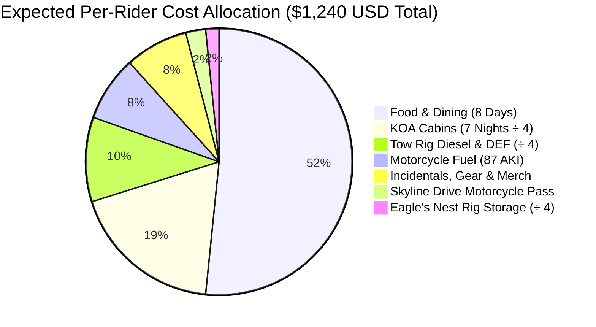

# Blue Ridge Parkway & Appalachian Twisties: Expedition Cost Breakdown (Per Person)
### 4-Rider Party • 2025 RAM 2500 Cummins Haul • 16-Ft Cargo Trailer • 7-Day Motorcycle Tour • 2,789.6 Total Miles (4,489.4 km)

---

## 1. Executive Summary: All-In Cost Per Rider

This budget analysis provides a realistic, comprehensive, itemized financial model for a **4-rider group originating from Hanmer, Ontario**, trailering four Honda motorcycles to **Front Royal, Virginia**, riding **Skyline Drive**, the **Blue Ridge Parkway**, the **Tail of the Dragon**, the **Cherohala Skyway**, and the **Back of the Dragon**, and returning door-to-door.

All shared fixed expenses (**RAM 2500 Cummins diesel & DEF**, **border tolls**, **Eagle's Nest trailer staging**, and **KOA cabins**) are split equally **4 ways**.

| Expense Category | Allocation Type | Budget Tier (Cookouts / Thrifty) | Expected Tier (KOA Cabins & Diners) | Comfort Tier (Private Hotel Rooms) | Expected CAD (@ 1.36 FX) |
| :--- | :---: | :---: | :---: | :---: | :---: |
| **Tow Rig Transit Diesel & DEF** (1,444 mi) | Shared (÷4) | $115 USD | **$127 USD** | $145 USD | ~$173 CAD |
| **Eagle's Nest Rig Storage** (1 Wk Staging) | Shared (÷4) | $18 USD | **$20 USD** | $25 USD | ~$27 CAD |
| **KOA Cabins / Lodging** (7 Nights) | Shared (÷4) | $195 USD | **$230 USD** | $520 USD *(Private)* | ~$313 CAD |
| **Motorcycle Fuel** (1,346 mi @ 87 AKI) | Individual | $90 USD | **$98 USD** | $110 USD | ~$133 CAD |
| **Skyline Drive 7-Day Motorcycle Permit** | Individual | $20 USD *(Pass Share)* | **$30 USD** | $30 USD | ~$41 CAD |
| **Food, Dining & Beverages** (8 Days) | Individual | $380 USD | **$640 USD** | $880 USD | ~$870 CAD |
| **Gear Buffer, Souvenirs & Incidentals** | Individual | $50 USD | **$95 USD** | $160 USD | ~$129 CAD |
| **TOTAL ESTIMATED COST PER RIDER** | **Per Person** | **$868 USD** | **$1,240 USD** | **$1,870 USD** | **~$1,686 CAD** |

> [!TIP]
> **Daily Rate**: For the expected touring standard (comfortable KOA cabins, daily sit-down barbecue/smokehouse dinners, and full gas tanks), the cost works out to approximately **$155 USD (~$210 CAD) per rider per day**.

---

## 2. Category Itemization & Cost Physics

---

### Category A: Tow Rig Transit Haul (Hanmer $\leftrightarrow$ Front Royal)
* **Total Highway Distance**: 720.3 mi outbound + 723.5 mi return = **1,443.8 miles (2,323.5 km)**.
* **Tow Vehicle**: 2025 RAM 2500 Crew Cab 4x4 (6.7L Cummins High-Output Turbo Diesel) towing a 16-foot tandem-axle enclosed trailer (~40 ft combined rig).
* **Fuel Economy**: ~12.5 mpg under mountain grades (US-219 / I-99 / Appalachian hills).
* **Total Diesel Required**: $1,443.8\text{ mi} / 12.5\text{ mpg} \approx \mathbf{115.5\text{ US gallons (437 L)}}$.
* **Fuel Cost Breakdown**:
  - *Ontario leg (Hanmer to Niagara)*: ~280 miles ($\approx 22.4\text{ gal / 85 L}$) @ ~$1.55 CAD/L $\approx \$132\text{ CAD (\$97 USD)}$.
  - *US leg (Lewiston, NY to Front Royal, VA)*: ~1,164 miles ($\approx 93.1\text{ gal}$) @ ~$3.85 USD/gal $\approx \$358\text{ USD}$.
  - *Total Diesel*: **~$455 USD**.
* **Diesel Exhaust Fluid (DEF)**: ~2 jugs (5 US gal) @ $18/jug = **$36 USD**.
* **Border Bridge Tolls**: Queenston-Lewiston Bridge ($5.00 USD outbound + $5.00 USD return) = **$10 USD**.
* **Turnpike / Highway Tolls (Optional E-ZPass bypasses)**: **$15 USD**.
* **Total Tow Rig Pool**: **$516 USD**.
* **Cost Per Rider (÷ 4)**: **$129.00 USD (~$175 CAD)**.

---

### Category B: Basecamp Rig Staging (Eagle's Nest RV & Storage)
* **Location**: Eagle's Nest RV, Boat & Vehicle Storage (3434 Guard Hill Rd, Front Royal, VA).
* **Service**: 7-day secure outdoor pull-through gravel staging with 24/7 keypad gate access and camera surveillance for 40-ft truck + trailer rig.
* **Weekly Storage Rate**: ~$80 USD total.
* **Cost Per Rider (÷ 4)**: **$20.00 USD (~$27 CAD)**.

---

### Category C: Overnight Lodging (7 Nights KOA Cabins)
All motorcycle overnights prioritize **KOA Holiday Campgrounds with Cabins** featuring bunk beds, double/queen beds, electric heat/AC, and fire pits:

| Night | Stage Target | Primary KOA Campground | Cabin Configuration | Nightly Pool Rate | Cost / Rider (÷ 4) |
| :---: | :--- | :--- | :---: | :---: | :---: |
| **0** | Front Royal (Staging) | Mountain View RV / Front Royal KOA Dr | 1 Cabin (Sleeps 4) | $130 USD | $32.50 USD |
| **1** | Waynesboro Gap | Charlottesville KOA Holiday | 1 Cabin (Sleeps 4) | $130 USD | $32.50 USD |
| **2** | Roanoke Gap | Lynchburg / Blue Ridge Parkway KOA | 1 Cabin (Sleeps 4) | $120 USD | $30.00 USD |
| **3** | Blowing Rock / High Country | Boone KOA Holiday | 1 Cabin (Sleeps 4) | $135 USD | $33.75 USD |
| **4** | Cherokee Terminus | Cherokee / Great Smokies KOA Holiday | 1 Deluxe Cabin | $155 USD | $38.75 USD |
| **5** | Bristol / Tri-Cities | Bristol / Kingsport KOA Holiday | 1 Cabin (Sleeps 4) | $120 USD | $30.00 USD |
| **6** | Shenandoah Valley | Natural Bridge / Lexington KOA Holiday | 1 Cabin (Sleeps 4) | $125 USD | $31.25 USD |
| **TOTAL** | **7 Overnight Stages** | **6 KOA Holidays + Basecamp Staging** | **Shared Cabins** | **$915 USD** | **$228.75 USD (~$311 CAD)** |

> [!NOTE]
> **Two Cabins Alternative**: If riders prefer 2 separate cabins per night (2 riders per cabin), the lodging pool is ~$1,800 USD, which equals **~$450 USD (~$612 CAD) per rider**.

---

### Category D: Motorcycle Fuel Dynamics (87 AKI Regular)
* **Total Motorcycle Route**: **1,345.8 miles (2,165.8 km)** across Virginia, North Carolina, and Tennessee.
* **Fleet Compression & Fuel Grade**: All four Hondas (10.0:1 to 10.5:1 compression) burn **87 AKI Regular Unleaded** exclusively. Zero chemical booster required.
* **Fleet Consumption**:
  - *2025 Africa Twin Adventure Sports ES DCT (24.8L)*: ~47 mpg $\rightarrow$ 28.6 gal.
  - *2018 Africa Twin #1 (18.8L)*: ~48 mpg $\rightarrow$ 28.0 gal.
  - *2018 Africa Twin #2 (18.8L)*: ~48 mpg $\rightarrow$ 28.0 gal.
  - *Honda Rebel 1100 (13.6L)*: ~44 mpg $\rightarrow$ 30.6 gal.
  - *Average Fuel per Motorcycle*: **~28.8 US gallons (109 Liters)**.
* **Average 87 AKI Pump Price**: ~$3.35 USD / gallon ($0.88 USD / L).
* **Cost Per Rider**: $28.8\text{ gal} \times \$3.35 \approx \mathbf{\$96.50\text{ USD (~$131 CAD)}}$.

---

### Category E: National Park Entry & Highway Tolls
* **Shenandoah National Park / Skyline Drive**:
  - Individual 7-Day Motorcycle Pass: **$30.00 USD** per bike.
  - *(Cost Saver: An "America the Beautiful" Interagency Annual Pass [$80 USD] covers up to two motorcycles if signed by the rider. Two passes cover all four bikes for $160 / 4 = $40 USD).*
* **Blue Ridge Parkway**: **$0.00** (Free National Parkway, zero tolls).
* **Tail of the Dragon (US-129)**: **$0.00** (Public Tennessee/NC highway).
* **Cherohala Skyway (NC-143 / TN-165)**: **$0.00** (Free National Scenic Byway).
* **Back of the Dragon (VA-16)**: **$0.00** (Free Virginia state highway).
* **Mount Mitchell State Park**: **$0.00** (Free public access to observation tower summit).
* **Cost Per Rider**: **$30.00 USD (~$41 CAD)**.

---

### Category F: Food, Dining, Craft Beer & Hydration (8 Days)
Calculated for high-energy mountain riding with leisurely sit-down evening meals:

| Meal Window | Description | Daily Cost / Rider | 8-Day Subtotal |
| :--- | :--- | :---: | :---: |
| **Breakfast & Coffee** (07:00 AM) | Diner eggs & bacon, buckwheat pancakes, bakery coffee | ~$14 USD | $112 USD |
| **Midday Lunch & Fuel** (12:00 PM) | Mabry Mill gristmill lunch, Peaks of Otter Lake View, wayside BBQ | ~$22 USD | $176 USD |
| **Evening Dinner & Drinks** (06:30 PM) | Appalachian smokehouses, craft burgers, local Virginia/NC breweries | ~$36 USD | $288 USD |
| **Trailside Snacks & Hydration** | Jerky, energy bars, trail mix, Gatorade/water bottles | ~$8 USD | $64 USD |
| **TOTAL DAILY FOOD** | **Full 8-Day Touring Cadence** | **~$80 USD / Day** | **$640.00 USD (~$870 CAD)** |

> [!TIP]
> **Camp Cooking & Grocery Option**: Bringing a camp stove and making KOA campfire dinners, sandwiches, and instant oatmeal drops this category to **~$45 USD/day (~$360 USD / rider)**.

---

### Category G: Incidentals, Gear Buffer & Souvenirs
* **Emergency Rain Gear Buffer**: Frogg Toggs Ultra-Lite2 suit at Bass Pro Shops Bristol if caught unprepared: **~$35 - $45 USD**.
* **Appalachian Twisties Memorabilia**: Tail of the Dragon / Deals Gap t-shirt, sticker, Back of the Dragon patch: **~$40 USD**.
* **Mechanical Maintenance Buffer**: Chain lube, microfiber towels, tire pressure top-ups, laundry tokens: **~$20 USD**.
* **Cost Per Rider**: **~$95.00 USD (~$129 CAD)**.

---

## 3. Group Settlement & Financial Execution

### Recommended Expense Tracking:
To keep settlement seamless and prevent awkward receipt sorting:
1. **Designate a "Tow Rig Captain"**: One rider puts all RAM 2500 diesel, DEF, border tolls, and Eagle's Nest storage on their primary credit card.
2. **Designate a "Lodging Coordinator"**: One rider books the 7 KOA cabins ahead of time.
3. **Use Splitwise / Tricount**: Log the group expenses into a shared mobile group.
4. **End-of-Tour Settlement**: Settle balances with a single **Interac e-Transfer** upon return to Hanmer.

### Financial Summary at a Glance:
* **Total Group Investment**: **~$4,960 USD (~$6,745 CAD)** for the entire 4-rider party.
* **Per Rider**: **~$1,240 USD (~$1,685 CAD)** all-in.
* **Value Assessment**: An incomparable price-to-adventure ratio for 2,789.6 miles of world-class mountain riding, 27 rock tunnels, 3 legendary twisties, and 7 nights in scenic Appalachian KOA cabins!
