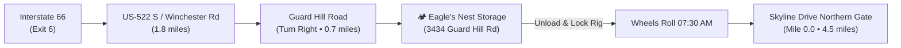

# Front Royal Basecamp & Secure Trailer Storage Dossier
### Eagle's Nest RV, Boat & Vehicle Storage • 3434 Guard Hill Rd, Front Royal, VA 22630

---

## 1. Facility Profile & Logistics Overview

When trailering motorcycles to the northern terminus of the Blue Ridge / Skyline corridor, staging the tow vehicle and enclosed cargo trailer in a secure, high-clearance facility is paramount. 

**Eagle's Nest RV, Boat & Vehicle Storage** is specifically engineered for full-size pickup trucks, commercial trailers, and enclosed toy haulers, eliminating the tight turning radii and residential restrictions of standard mini-storage units.

| Facility Attribute | Details & Specifications |
| :--- | :--- |
| **Official Name** | **Eagle's Nest RV, Boat & Vehicle Storage** |
| **Physical Address** | 3434 Guard Hill Road, Front Royal, VA 22630 |
| **GPS Coordinates** | `38.9612° N, 78.2045° W` (38.96120, -78.20497) |
| **Telephone** | **+1 540-636-6161** |
| **Web Portal** | [frontroyalvehiclestorage.com](https://frontroyalvehiclestorage.com/) |
| **Proximity to Skyline Drive** | **4.5 miles (~8 minutes)** to Front Royal Northern Entrance Station (Mile 0.0) |
| **Proximity to Interstates** | 2.5 miles from Interstate 66 (Exit 6) / 10 miles from Interstate 81 |
| **Security Architecture** | Full perimeter commercial security fence, electronic keypad entry gate, 24/7 high-definition motion cameras, exterior dusk-to-dawn floodlights |
| **Access Lanes** | Extra-wide crushed gravel and asphalt driving aisles designed for 45+ ft combined rig pull-throughs |

---

## 2. Arrival Routing & Staging Navigation

### From Interstate 66 (Eastbound / Westbound):
1. Take **Exit 6** for **US-340 / US-522** toward Front Royal / Winchester.
2. Head south on **US-522 S / Winchester Rd** for 1.8 miles.
3. Turn right onto **Guard Hill Road (State Route 637)**.
4. Proceed 0.7 miles west along Guard Hill Rd; the gated entrance to **Eagle's Nest RV Storage** will be on your right.

---

## 3. Pre-Departure Rig & Trailer Lockup Protocol

Before rolling your 4 Honda motorcycles out the gate on Day 1, execute this 8-point physical security and weatherproofing checklist:

1. **Coupler Ball Lock**: Install a heavy-duty hardened-steel coupler lock (e.g., *Proven Industries 217-A* or *Reese Towpower*) directly over the trailer tongue to prevent unauthorized hitching.
2. **Wheel Chock & Dual-Axle Lock**: For tandem axle trailers, install a locking between-the-wheel chock (e.g., *X-Chock* or *Trimax Wheel Lock*) on the curb side.
3. **Safety Chains Padlock**: Padlock the safety chains back onto the trailer tongue rather than letting them dangle on the gravel (prevents chains from being used as tow points).
4. **Cargo Ramp / Door Padlocks**: Secure all cam-bar latches and ramp door handles with matching boron-carbide shackle disc locks (e.g., *Master Lock Magnum M40XD*).
5. **Tow Vehicle Interior**: Remove all high-value items, tool chests, GPS units, and motorcycle jackets from the truck cab. Place remaining ratchet straps and wheel chocks inside the locked cargo trailer.
6. **Battery Disconnect**: If your cargo trailer features an onboard 12V breakaway battery, disconnect or isolate parasitic loads (interior dome lights).
7. **Tire Pressure Record**: Before leaving the rig parked for 7 days, verify cold tire pressure on all trailer tires (typically 50–65 PSI for ST radials) so they are road-ready upon your return.
8. **Gate Access Code Confirmation**: Store your 4-digit or 6-digit electronic gate keypad code into both lead riders' phones and verify gate operating hours (typically 24/7 or 06:00 AM to 10:00 PM).

---

## 4. Local Front Royal Expedition Amenities & Staging Hubs

If arriving the afternoon/evening before Day 1 rollout (Night 0):

### Recommended Night 0 Staging Hotels (Rig-Friendly Parking):
- **Hampton Inn Front Royal**: 9800 Winchester Rd, Front Royal, VA 22630 | Phone: +1 540-635-1882 *(Large rear parking lot suitable for truck + trailer combo)*.
- **Quality Inn Skyline Drive**: 10 Commerce Ave, Front Royal, VA 22630 | Phone: +1 540-635-3161 *(Directly at base of mountain; ground-level exterior door access)*.

### Hardware, Ratchet Straps & Towing Supplies:
- **Tractor Supply Co.**: 3401 Shenandoah Ave, Front Royal, VA 22630 | Phone: +1 540-635-5151 *(Spare 2-inch ratchet straps, hitch pins, grease, trailer light bulbs)*.
- **Lowe's Home Improvement**: 1200 S Commerce Ave, Front Royal, VA 22630 | Phone: +1 540-635-0400.

### Pre-Rollout Fuel & Staging Diner:
- **Sheetz Front Royal**: 1440 Shenandoah Ave, Front Royal, VA 22630 *(24/7 87 AKI Regular fuel, fresh breakfast sandwiches, tire air station)*.
- **Daily Grind Coffee House**: 137 E Main St, Front Royal, VA 22630 *(Espresso, local breakfast pastries, 06:30 AM open)*.
