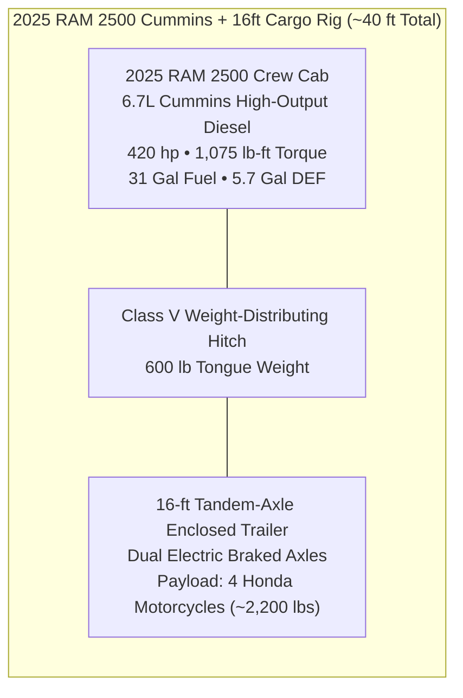
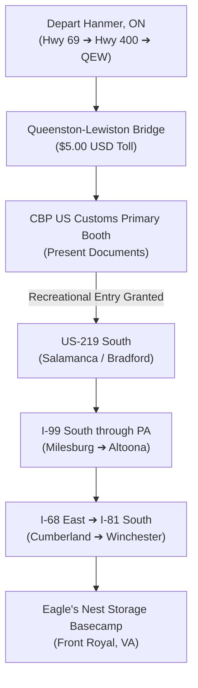

# Outbound & Return Rig Transit: Hanmer, ON to Front Royal, VA
### 2025 RAM 2500 Cummins 6.7L Turbo Diesel • 16-Foot Enclosed Cargo Trailer (4 Motorcycles) • 720 Miles Each Way

---

## 1. Tow Rig Powertrain & Trailer Specifications

This operational guide governs the highway transit of the expedition party's primary haul vehicle: a **2025 RAM 2500 Heavy Duty Crew Cab** towing a **16-foot tandem-axle enclosed cargo trailer** carrying all 4 Honda motorcycles, riding gear, and tools.



### Powertrain & Haul Metrics:
* **Tow Vehicle**: 2025 RAM 2500 Heavy Duty Crew Cab 4x4.
* **Engine**: 6.7L Cummins High-Output Turbo Diesel Inline-6 (420 hp / 1,075 lb-ft torque).
* **Transmission**: Heavy-Duty 6-speed automatic with integrated **Tow/Haul Mode** and smart **Exhaust Brake**.
* **Fuel Capacity**: **31.0 US Gallons (117 Liters)** Ultra-Low Sulfur Diesel (ULSD).
* **DEF Tank Capacity**: **5.7 US Gallons (21.6 Liters)**.
* **Towing Fuel Economy**: **~12.0 to 13.5 mpg** (19.6 to 17.4 L/100 km) towing an aerodynamic box trailer at 65–70 mph.
* **Safe Diesel Range**: **~340 to 380 miles (550 to 610 km)** between fill-ups.
* **Trailer**: 16-foot enclosed tandem-axle V-nose cargo trailer with electric trailer brakes and interior E-track tie-down rails.
* **Combined Rig Length**: **~39.5 to 40.0 feet (12.2 meters)** bumper-to-bumper.

---

## 2. 4-Motorcycle Trailer Floor Plan & Weight Distribution

Proper weight distribution inside an enclosed trailer is the single most critical factor in eliminating high-speed trailer sway on interstate highways:

```
+------------------ 16-Foot Enclosed Cargo Floor Plan ------------------+
|                                  [V-NOSE]                              |
|                                                                        |
|   [Bike 1: Africa Twin ES DCT]        [Spare Tires / Tool Box]        |
|     (Front Left Chock - 550 lbs)          (Tool Chest Centered)        |
|                                                                        |
|                   [Bike 2: Africa Twin #1]                             |
|                    (Front Right - Staggered 14" back - 505 lbs)        |
|                                                                        |
|                           == AXLE CENTERLINE ==                        |
|                                                                        |
|   [Bike 3: Africa Twin #2]            [Bike 4: Honda Rebel 1100]       |
|     (Mid Left - 505 lbs)                (Mid Right - 487 lbs)          |
|                                                                        |
|   [Gear Bags / Riding Gear]           [Ramps / Jack / Wheel Chocks]    |
|                                                                        |
+--------------------------- [REAR RAMP DOOR] ---------------------------+
```

### 5-Point Trailer Security Rules:
1. **60/40 Front Weight Bias**: Place 60% of the total cargo mass forward of the trailer axle centerline. This yields a tongue weight of **550 to 650 lbs (10–12% of gross trailer weight)**, ensuring absolute straight-line stability at 70 mph.
2. **Staggered Motorcycle Loading**: Stagger the front wheel chocks by 12–14 inches between the left and right sides to prevent handlebars, handguards, and mirrors from clashing during transit.
3. **4-Point Cam/Ratchet Compression**: Secure each motorcycle with 4 heavy-duty ratchet straps. Use soft loops around the lower triple clamp, compressing the front suspension by 1.5 to 2.0 inches. Attach two rear tie-downs to passenger peg brackets or subframes to prevent lateral kick-out.
4. **Safety Breakaway Cable**: Verify the trailer breakaway battery is charged and clip the emergency lanyard directly to the RAM 2500 hitch receiver frame (never wrap around the safety chains).
5. **Cold Tire Pressure**: Inflate trailer ST radial tires to **50–65 PSI cold** (per sidewall stamping) and truck rear tires to **70–80 PSI cold**.

---

## 3. Cross-Border Trailering Protocols (Canada ➔ USA & Return)

### Recommended Crossing: **Queenston-Lewiston Bridge (Niagara / Lewiston, NY)**
The Queenston-Lewiston Bridge features dedicated wide-lane commercial/truck inspection plazas with high-clearance overhead canopies, making it far superior to the congested downtown Peace Bridge when towing a 40-foot combined rig.



### Mandatory Border Documents Checklist:
1. **Passports**: Valid Canadian passports for all passengers in the truck.
2. **RAM 2500 Registration**: Original Ontario Vehicle Ownership Permit (Green Slip).
3. **16-ft Cargo Trailer Registration**: Original trailer ownership permit and valid license plate validation.
4. **Motorcycle Ownerships**: Original green ownership slips (or clear certified copies) for all 4 Honda motorcycles inside the trailer. US Customs officers may match the VIN plates on the steering stems to your ownership documents.
5. **Clear Declaration Script**:
   > *"Good morning officer. We are on a recreational motorcycle touring vacation to ride the Blue Ridge Parkway in Virginia and North Carolina for 7 days. We have four personal motorcycles secured inside our cargo trailer which will return with us to Ontario."*
6. **Agricultural Prohibitions**: Do not bring citrus fruits, apples, raw firewood, or fresh uninspected meats across the border. Empty all fresh produce before reaching the bridge.
7. **Return into Canada (CBSA)**: When returning via the Queenston-Lewiston Bridge on Day 8, declare all merchandise, apparel, or motorcycle parts purchased in the US. Keep all receipts organized in the truck console.

---

## 4. Highway Transit Corridor (720.3 Miles / 1,159.2 km)

### Turn-by-Turn Corridor Breakdown:
- **Leg 1 (Northern Ontario Corridor • 240 mi / ~3h 50m)**:
  - Depart Hanmer, ON south on **Hwy 69 / Trans-Canada** through Sudbury and Parry Sound.
  - Merge onto **Hwy 400 South** past Barrie.
  - *Rest Stop*: **ONroute Innisfil** (diesel, DEF jugs, Tim Hortons).
- **Leg 2 (Golden Horseshoe & Border • 105 mi / ~1h 45m)**:
  - Hwy 400 South $\rightarrow$ **Hwy 407 ETR** (fast electronic toll bypass avoiding Toronto congestion) or Hwy 401 West.
  - Merge onto **QEW (Queen Elizabeth Way)** past Hamilton and St. Catharines to Niagara.
  - Cross **Queenston-Lewiston Bridge** into Lewiston, New York.
- **Leg 3 (Western New York & PA Wilds • 140 mi / ~2h 15m)**:
  - Follow **I-190 South** through Buffalo to **I-90 West** (10 miles).
  - Take Exit 55 for **US-219 South** expressway through Orchard Park and Springville.
  - Continue on US-219 through Salamanca, NY into Pennsylvania past Bradford.
- **Leg 4 (Central Pennsylvania Mountain Corridor • 115 mi / ~1h 50m)**:
  - Follow PA-255 / US-219 south to **Interstate 80 East**.
  - Run I-80 East for 12 miles to **Exit 158 (Milesburg / Bellefonte)**.
  - *Major Truck Stop*: **Pilot Travel Center Milesburg** (I-80 / I-99).
  - Merge onto **Interstate 99 South** past State College and Altoona.
- **Leg 5 (Appalachian Ridge Transition • 120 mi / ~2h 00m)**:
  - Follow I-99 South to Bedford, merging onto **US-220 South** down into Cumberland, Maryland.
  - Take **Interstate 68 East** across Sideling Hill to Hancock, MD.
  - Merge onto **Interstate 81 South** through Hagerstown, MD into Winchester, Virginia.
  - Take **Exit 323** (Winchester) onto **US-522 South** for 15 miles into Front Royal.
  - Turn right onto Guard Hill Road to **Eagle's Nest RV, Boat & Vehicle Storage**!

---

## 5. Strategic Commercial Diesel Truck Stops (Trailer Pull-Throughs)

Avoid tight passenger gas stations. The following vetted truck plazas feature high-clearance canopies (14'6"+), dedicated satellite diesel pumps, bulk DEF at the pump, and wide turning lanes:

| Station & Brand | Highway Location | Coordinates | Facilities & Amenities | Staging Distance |
| :--- | :--- | :---: | :--- | :---: |
| **1. ONroute Innisfil** | Hwy 400 Southbound (Between Barrie & Innisfil) | `44.3125, -79.6739` | High-flow Esso diesel, DEF jugs, Tim Hortons, wide trailer parking | 175 mi from Hanmer |
| **2. Flying J Travel Center** | QEW Exit 7 (St. Catharines / Niagara, ON) | `43.1489, -79.1678` | Commercial truck lanes, bulk DEF, Denny's, pre-border staging | 135 mi from Innisfil |
| **3. Sunoco / Kwik Fill** | US-219 (Springville / West Seneca, NY) | `42.5056, -78.6789` | Easy high-clearance diesel stop south of Buffalo | 65 mi from Border |
| **4. Pilot Travel Center** *(Primary PA Fuel Hub)* | I-80 / I-99 Exit 158 (Milesburg / Bellefonte, PA) | `40.9456, -77.7789` | Full commercial truck stop, satellite diesel, bulk DEF at pump, Subway | 175 mi from Springville |
| **5. Pilot Travel Center** | I-68 Exit 44 (Cumberland, MD) | `39.6789, -78.7056` | Mountain corridor diesel refueling, Wendy's, DEF | 85 mi from Milesburg |
| **6. Pilot Travel Center** | I-81 Exit 323 (Winchester, VA) | `39.2456, -78.1342` | Final pre-basecamp diesel top-up, CAT scale, bulk DEF | 65 mi from Cumberland |
| **7. Pilot Travel Center** *(Finish Recovery)* | I-66 / US-522 (Front Royal, VA) | `38.9612, -78.2045` | Basecamp diesel fueling before return haul to Hanmer | 20 mi from Winchester |

---

## 6. RAM 2500 Cummins Driving & Towing Settings

To ensure maximum powertrain life, safety, and brake longevity:

1. **Tow/Haul Mode**: Press the **TOW/HAUL** button on the center stack immediately after starting the engine. This locks the torque converter earlier, holds gears longer during acceleration, and prevents gear hunting on Pennsylvania and Maryland grades.
2. **Smart Exhaust Brake (Full vs. Auto)**:
   - **Auto Mode**: Ideal for rolling interstate cruising. Maintains your selected cruising speed when you lift off the accelerator.
   - **Full Mode**: Press twice for mountain descents (descending from Sideling Hill on I-68 or the Allegheny Front on US-219). The 6.7L Cummins turbo vanes close down, providing up to **400 braking horsepower** and holding the 40-foot rig at safe downhill speeds without touching the service brakes!
3. **Integrated Trailer Brake Controller**:
   - Set trailer type to **Electric**.
   - Set brake effort to **Medium**.
   - Initial gain recommendation: **6.0 to 6.5**. Test at 25 mph in a parking lot by squeezing the manual slider; trailer brakes should stop the rig firmly without locking trailer wheels.
4. **DEF Consumption Management**:
   - The RAM 2500 carries **5.7 gallons of DEF**.
   - Towing consumption is ~1 gallon per 300–350 miles.
   - Starting with a 100% full tank in Hanmer covers the entire 720-mile outbound transit.
   - Top off the DEF tank at the **Pilot Travel Center in Winchester or Milesburg** on the return haul (or carry one 2.5-gal jug in the bed).

---

## 7. Itinerary Scheduling Options: 1-Day Push vs. 2-Day Split

### Option A: The 1-Day Push (Recommended for Experienced Haulers)
* **05:00 AM**: Roll out from Hanmer, ON (full 31-gal fuel tank).
* **08:45 AM**: Quick fuel & breakfast stretch at ONroute Innisfil (Hwy 400).
* **10:30 AM**: Cross Queenston-Lewiston Bridge into US (CBP inspection).
* **01:30 PM**: Major diesel & lunch stop at Pilot Travel Center Milesburg, PA (I-80 / I-99).
* **05:30 PM**: Arrive in Front Royal, VA. Check in at Hampton Inn / Quality Inn.
* **Evening**: Drop and lock cargo trailer at Eagle's Nest RV Storage, inspect bikes, enjoy dinner.

### Option B: The 2-Day Leisure Split (Split at the Border)
* **Day 0A**: Hanmer to Buffalo / East Aurora, NY or Bradford, PA (360–400 mi / ~6.5 hrs). Cross border in afternoon, enjoy hotel dinner.
* **Day 0B**: Bradford / DuBois, PA to Front Royal, VA (320 mi / ~5.5 hrs). Arrive midday, drop trailer at Eagle's Nest Storage, prep 4 motorcycles for Day 1 rollout onto Skyline Drive!
